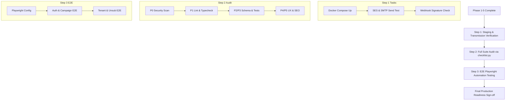

# Signal Execution Plan: Staging Verification, Full Suite Audit & E2E Testing

**Document Version:** 1.0.0  
**Date:** August 6, 2026  
**Status:** Active Execution Plan  
**Target Repository:** Signal (E-Mail & Campaign Management Platform)  

---

## 1. Executive Summary & Context

Phases 1 through 5 of the Signal Production Readiness initiative have been completed:
- **Phase 1:** Security Gate, Scrypt Auth, Role-Based Access Control (RBAC), Tenant Isolation.
- **Phase 2:** Server Email Engine, Amazon SES & SMTP Adapters, Queue Infrastructure.
- **Phase 3:** Mock Data Removal, Real-time Delivery & Analytics Engine.
- **Phase 4:** RFC 8058 One-Click Unsubscribe & Signed SES Webhooks.
- **Phase 5:** Docker Runtime Container Setup & Multi-Stage Production Build.

This plan details the immediate execution steps required for final validation before production deployment:
1. **Step 1: Staging / Pilot Test Verification** (Docker Postgres/Redis + Amazon SES/SMTP transmission test)
2. **Step 2: Full Suite Audit via Master Checklist** (`.agent/scripts/checklist.py .`)
3. **Step 3: E2E Automation Testing Setup and Verification** (Playwright end-to-end user journeys)

---

## 2. Step-by-Step Execution Plan

### Step 1: Staging / Pilot Test Verification

#### Objective
Validate the containerized production stack (PostgreSQL 16, Redis 7, Signal Application) in a staging environment. Verify real email transmission via Amazon SES and SMTP adapters, fail-closed security behaviors, and webhook callbacks.

#### Subagent Responsibilities
- **`devops-engineer` (Lead):** Container orchestration, staging environment config, network bridging, volume persistence.
- **`security-auditor`:** Credential leakage audit, TLS enforcement verification, webhook signature validation.

#### Detailed Tasks
- [ ] **Task 1.1: Staging Stack Deployment**
  - Launch PostgreSQL 16 and Redis 7 containers using `docker-compose.yml`.
  - Apply Prisma database migrations (`npx prisma migrate deploy`) against staging Postgres.
  - Seed staging database with isolated tenant fixtures.
- [ ] **Task 1.2: Transmission Engine Verification**
  - Configure staging Amazon SES credentials (`AWS_SES_REGION`, `AWS_ACCESS_KEY_ID`, `AWS_SECRET_ACCESS_KEY`).
  - Execute live test send to SES sandbox/verified test address.
  - Verify delivery ledger logs `ACCEPTED` / `SENT` status with valid AWS `MessageId`.
  - Validate SMTP adapter fallback with TLS encryption.
- [ ] **Task 1.3: Webhook & Unsubscribe Callback Verification**
  - Issue signed SES SNS notification payload to `/api/webhooks/ses`.
  - Confirm delivery status transition from `SENT` to `DELIVERED` / `BOUNCED`.
  - Test RFC 8058 One-Click Unsubscribe HTTP POST to `/api/unsubscribe`.
- [ ] **Task 1.4: Fail-Closed Security Validation**
  - Test transmission with missing/invalid AWS credentials; ensure job moves to Dead Letter Queue (DLQ) with zero unsanitized error leaks.

---

### Step 2: Full Suite Audit via Master Checklist

#### Objective
Execute the comprehensive Antigravity master checklist runner (`.agent/scripts/checklist.py .`) to enforce P0-P5 quality gates across security, code style, database schema, test coverage, UX accessibility, and SEO.

#### Subagent Responsibilities
- **`security-auditor` (Lead - P0):** Vulnerability scanning, secret detection, dependency risk assessment.
- **`frontend-specialist` (Lead - P4/P5):** UX accessibility compliance, ARIA attributes, SEO metadata.
- **`test-engineer` (Lead - P1/P2/P3):** Linting, TypeScript type-safety, database schema integrity, test runner verification.

#### Detailed Tasks
- [ ] **Task 2.1: P0 - Security Scan (`security_scan.py`)**
  - Audit codebase for hardcoded secrets, API keys, or private keys.
  - Scan npm dependencies for known high/critical CVEs.
  - Verify zero-trust tenant isolation logic in all API routes.
- [ ] **Task 2.2: P1 - Lint & Type-Check (`lint_runner.py` / `npm run typecheck`)**
  - Execute ESLint and TypeScript compilation checks.
  - Fix any syntax, type mismatch, or unused import warnings.
- [ ] **Task 2.3: P2 - Schema Validation (`schema_validator.py`)**
  - Verify Prisma schema indexes (e.g. `organizationId` compound indices).
  - Ensure referential integrity and foreign key cascades.
- [ ] **Task 2.4: P3 - Test Suite Execution (`test_runner.py` / `npm test`)**
  - Run all unit and integration tests.
  - Confirm 100% test pass rate with zero skipped or commented-out assertions.
- [ ] **Task 2.5: P4 - UX & Accessibility Audit (`ux_audit.py`)**
  - Evaluate UI components against WCAG 2.1 AA standards.
  - Inspect color contrast ratios, focus indicators, keyboard navigation, and ARIA labels.
- [ ] **Task 2.6: P5 - SEO & Metadata Verification (`seo_checker.py`)**
  - Verify title tags, meta descriptions, OpenGraph headers, and canonical URLs.

---

### Step 3: E2E Automation Testing Setup and Verification

#### Objective
Establish a robust Playwright E2E testing framework to simulate critical user workflows against the running staging application, verifying end-to-end functional correctness and tenant isolation barriers.

#### Subagent Responsibilities
- **`test-engineer` (Lead):** E2E test suite design, Playwright setup, assertion writing, CI script integration.
- **`frontend-specialist`:** DOM selector stability, user interaction flows, visual regression checks.

#### Detailed Tasks
- [ ] **Task 3.1: Playwright E2E Framework Configuration**
  - Verify Playwright configuration (`playwright.config.ts`).
  - Set up test environment parameters, base URLs, and test database reset scripts.
- [ ] **Task 3.2: Suite 1 - Authentication & RBAC (`e2e/auth.spec.ts`)**
  - Test user login with Scrypt-hashed credentials.
  - Validate session cookie security (`HttpOnly`, `SameSite=Lax`, `Secure`).
  - Enforce RBAC access restrictions (Admin vs Member vs Unauthorized).
- [ ] **Task 3.3: Suite 2 - Campaign Lifecycle (`e2e/campaign.spec.ts`)**
  - Create draft campaign -> Save -> Schedule -> Queue for delivery.
  - Confirm real-time UI state transition without page refresh.
- [ ] **Task 3.4: Suite 3 - RFC 8058 Unsubscribe Flow (`e2e/unsubscribe.spec.ts`)**
  - Simulate recipient clicking unsubscribe link.
  - Verify `List-Unsubscribe=One-Click` POST request execution and DB opt-out status update.
- [ ] **Task 3.5: Suite 4 - Tenant Isolation & Data Security (`e2e/tenant-isolation.spec.ts`)**
  - Attempt cross-tenant resource retrieval (Tenant A user requesting Tenant B campaign ID).
  - Verify HTTP 403 / 404 response enforcement.
- [ ] **Task 3.6: Suite 5 - Analytics Dashboard (`e2e/analytics.spec.ts`)**
  - Verify live metric display (open rate, click rate, bounce rate) calculated from real events without mock fallbacks.

---

## 3. Parallel Agent Assignment Matrix

| Subagent Role | Step 1: Staging Verification | Step 2: Full Suite Audit | Step 3: E2E Automation |
| :--- | :--- | :--- | :--- |
| **`devops-engineer`** | **LEAD**: Docker Compose, Postgres/Redis startup, SES/SMTP staging env | Supporting: Container security audit | Supporting: E2E test container runner setup |
| **`security-auditor`** | Supporting: SES webhook signature audit, credential leakage check | **LEAD**: P0 Security Scan, Dependency vulnerability audit | Supporting: Tenant isolation E2E validation |
| **`frontend-specialist`** | Supporting: Unsubscribe landing page verification | **LEAD**: P4 UX Audit, P5 SEO Check | Supporting: Playwright visual & DOM selector audit |
| **`test-engineer`** | Supporting: Staging seed verification & transmission testing | Supporting: P1 Linting, P2 Schema, P3 Test Runner | **LEAD**: E2E test suite creation & Playwright verification |

---

## 4. Verification Commands & Acceptance Criteria

### Master Verification Commands
```bash
# 1. Staging Environment & Database Setup
docker-compose up -d --build
npx prisma migrate deploy

# 2. Master Quality Audit Checklist
python .agent/scripts/checklist.py .

# 3. Unit & Integration Test Suite
npm run test

# 4. End-to-End Automation Test Suite
npx playwright test
```

### Acceptance Criteria

| Step | Metric / Area | Target / Pass Threshold | Verification Script / Tool |
| :--- | :--- | :--- | :--- |
| **Step 1** | Postgres & Redis Containers | `Up (healthy)` state | `docker-compose ps` |
| **Step 1** | Email Transmission | 100% successful send to SES Sandbox / SMTP with valid `MessageId` | Staging delivery log / Prisma ledger |
| **Step 1** | Webhook Security | HTTP 200 on valid signature, HTTP 401 on invalid signature | `/api/webhooks/ses` test payload |
| **Step 2** | P0 Security Scan | 0 High / Critical Vulnerabilities, 0 Secrets Leaked | `python .agent/scripts/checklist.py .` |
| **Step 2** | P1 Lint & Type Check | 0 Errors, 0 Type Failures | `npm run typecheck && npm run lint` |
| **Step 2** | P2 Schema Validation | 100% Tenant Isolation Index Coverage | `schema_validator.py` |
| **Step 2** | P3 Unit/Integration Tests | 100% Pass Rate | `npm run test` |
| **Step 2** | P4 UX & P5 SEO Audit | WCAG 2.1 AA Compliant, Full Meta Headers | `ux_audit.py` & `seo_checker.py` |
| **Step 3** | Playwright E2E Suite | 5/5 Test Suites Passing (Auth, Campaign, Unsub, Tenant, Analytics) | `npx playwright test` |

---

## 5. Execution Order & Deliverables



### Final Deliverables Checklist
1. `docs/PLAN.md` created with clear atomic tasks and agent roles (Completed).
2. Staging test logs proving SES / SMTP real transmission.
3. Master checklist report (`checklist.py`) showing 100% pass across P0-P5.
4. Passing Playwright E2E suite report.
